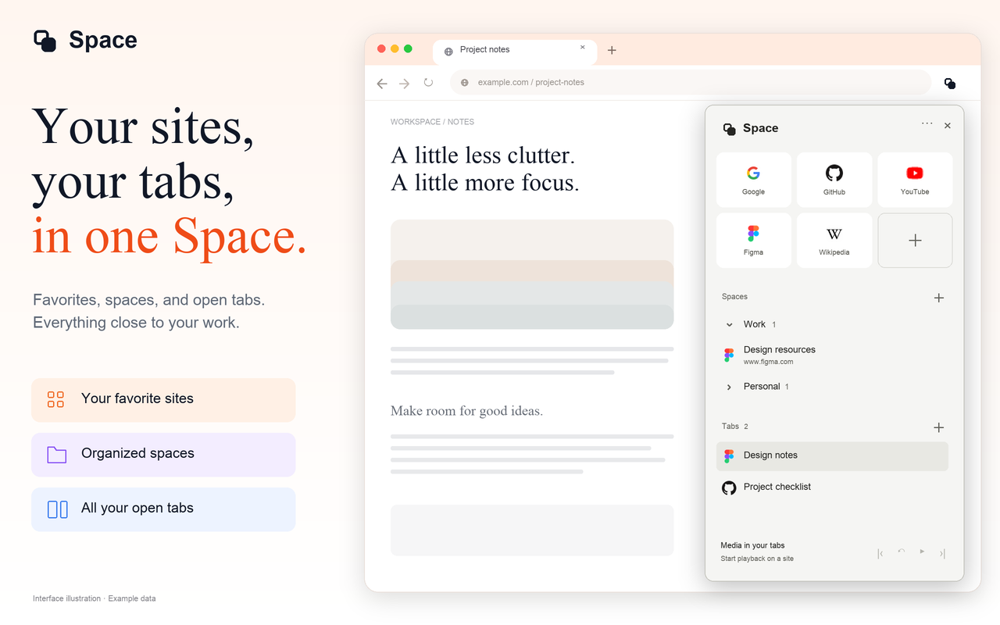
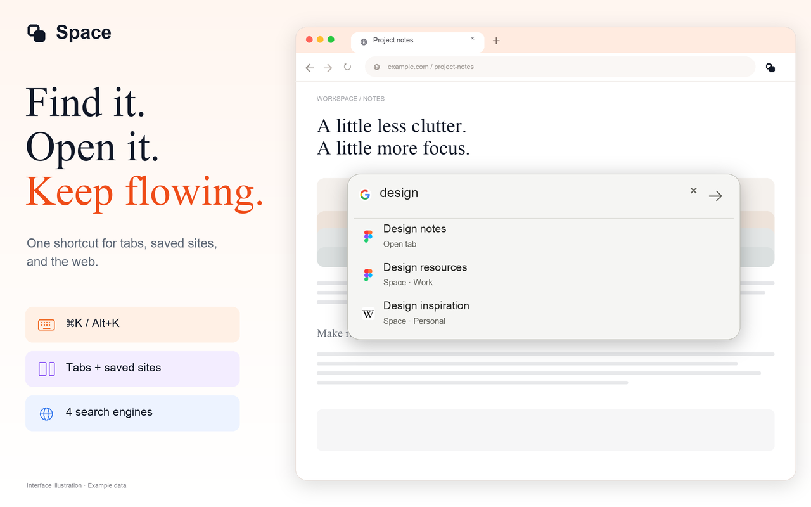
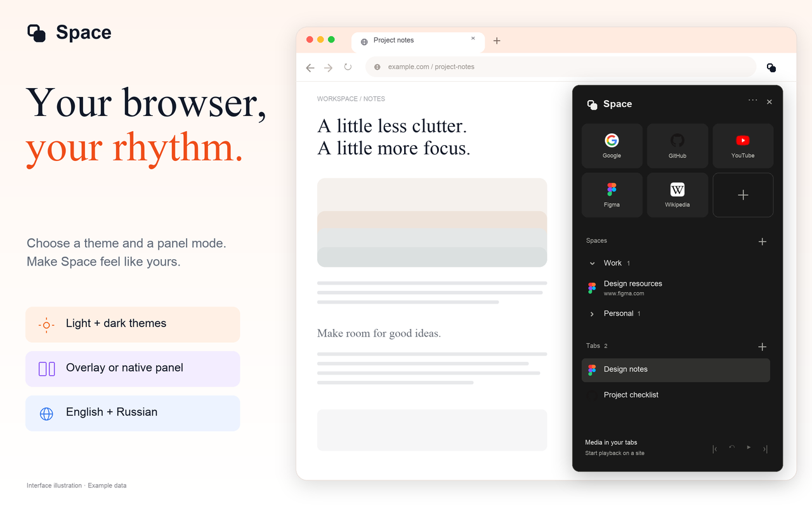

# Space

[](https://github.com/javedius/side-panel/actions/workflows/ci.yml)

A quiet Chrome sidebar for favorite sites, named spaces, open tabs, and quick search. The interface supports English and Russian, following Chrome’s system/interface language by default. The Chrome Web Store listing remains in English.

## Interface previews

English interface illustrations with example data, using a warm editorial layout with serif headlines, orange accents, and pastel feature labels. Prepared as opaque **1280×800 PNG** images. These are rendered previews of the current features, not captures of a running browser.

### Favorites, spaces, and tabs



### Quick search



### Themes and panel modes



[Download the PNG files and view their provenance](store/screenshots/README.md).

## Load in Chrome

Clone this repository or use **Code → Download ZIP** on GitHub and extract it:

```sh
git clone https://github.com/javedius/side-panel.git
cd side-panel
```

1. Open `chrome://extensions` and enable Developer mode.
2. Choose **Load unpacked** and select this project directory — the folder containing `manifest.json`.
3. Reload the extension and refresh existing websites after updating it.

The manifest remains at the original project root, so an existing unpacked installation can keep using the same directory. Storage keys and backup format are unchanged. Your saved site/space names are not translated or replaced.

## Use

- **Command+J** on Mac or **Alt+J** on Windows/Linux toggles the sidebar.
- **Command+K** on Mac or **Alt+K** on Windows/Linux opens quick search.
- Enter an address to open a new tab, or ordinary text to search with the selected provider.
- Arrow keys or Tab select a matching open tab or saved site; Enter activates it.
- Drag sites to reorder/move them, or save an ordinary tab by dragging it into Favorites or a space. Menu actions provide non-drag alternatives.
- **Panel menu → Backup** exports/imports sites, spaces, and settings. Import includes a preview and keeps the previous state for recovery.
- Website icons appear in Favorites, Spaces, Tabs, and quick-search results. A neutral website mark appears when an icon is unavailable.
- **Panel settings** contains language, theme, panel mode, site button, shortcuts, and privacy information.

**Panel settings → Appearance → Language** offers **System default**, **English**, and **Русский**. Automatic mode uses Chrome’s UI language (with the system/browser language as a preview fallback); unsupported languages use English. Language is saved locally, included in backups, and shared by the sidebar, search, and site button. Your site and space names are never translated.

Chrome can leave conflicting shortcuts unassigned. Check **Panel settings → Keyboard** to view or change the actual assignments.

## Project layout

```text
manifest.json       Chrome entry point (kept at the project root)
src/                Extension code and pages, grouped by responsibility
  background/       Service worker and search request handling
  content/          Website-injected sidebar/search/media hooks
  panel/            Sidebar UI, settings, menus, and drag/drop
  search/           Search UI and matching/address model
  backup/           Backup validation and dialog
  spaces/           Space configuration and validation
  sites/            Site ordering and transfers
  tabs/             Live tab associations
  media/            Playback controller
  shared/           Resource paths, translations, theme tokens, startup hydration
  privacy/          Canonical English privacy page
_locales/           English/Russian Chrome metadata
assets/icons/       Extension icons
store/              English store copy, artwork, and screenshot plan
tests/              Model, controller, and UI-adapter tests
docs/               Architecture, product/UX contracts, history, verification
scripts/            Checks, tests, artwork rendering, and packaging
release/            Current packages, metadata, hashes; older releases in archive/
reports/            Generated audit output
DESIGN.md           Maintained visual design context
```

## Development

Requirements: Node.js 24+ and Python 3. No runtime npm dependencies or application build step are needed.

```sh
npm run check       # JS syntax, manifest/resource graph, translation coverage/placeholder checks
npm test            # All model/controller/UI-adapter tests
npm run package     # Extension ZIP and English Chrome Web Store kit
npm run verify      # All of the above
```

Resource URLs used by Chrome APIs are centralized in `src/shared/paths.js`; document/module imports remain relative. Packaging checks all resource references and ships only the manifest, `src/`, `_locales/`, and icon assets. There are no copies of runtime scripts at the project root.

Generated release archives and listing metadata live in `release/` and are excluded from version control. Run `npm run package` to create them after cloning. GitHub Actions runs the full verification workflow on pushes and pull requests. Artwork generation uses Pillow and system Arial fonts; pre-rendered PNG/SVG assets are supplied in `store/`, so packaging does not require image libraries.

See `docs/architecture.md` for ownership and migration details and `docs/verification.md` for the scope of automated checks. UI adapters are not evidence of physical Chrome hotkey/drag behavior or actual browser screenshots.

## Chrome Web Store

Run `npm run package`, then use `release/space-1.22.0.zip` as the extension upload. `release/space-web-store-kit-1.22.0.zip` contains artwork, English listing copy, review notes, the privacy page for public hosting, and the extension ZIP.

Actual current-version screenshots and a public HTTPS privacy-policy URL are still required before submitting. See `store/README.md`. The kit includes clearly labeled interface illustrations and editable sources; it does not claim they are live browser captures or invent publisher/contact details.

Earlier product notes and verification records are retained in `docs/history.md` and the other `docs/` files; paths in historical entries describe the layout at the time.
